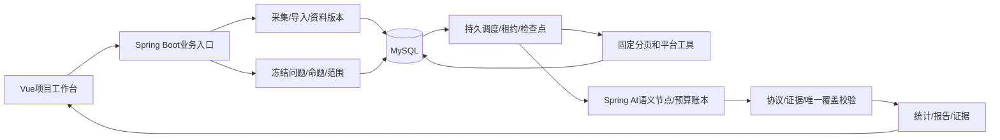
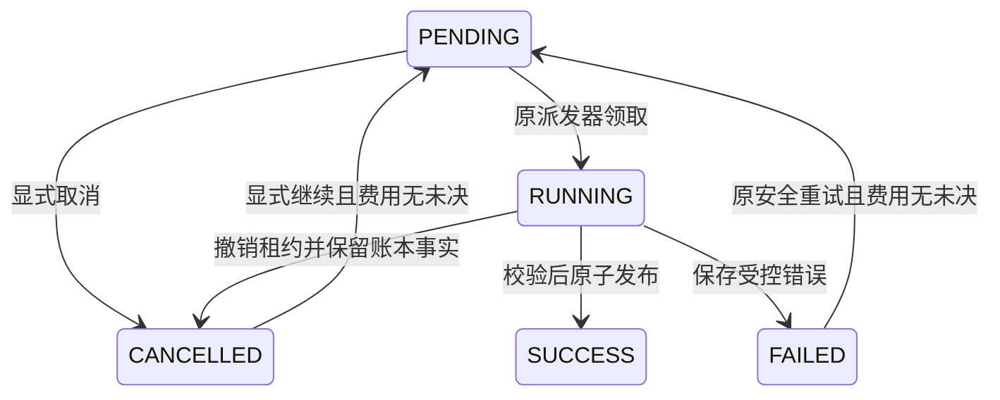

# EchoInsight 产品与开发基准 v2.6

维护修订：2026-10-19，第68～77轮。本文合并产品范围、业务字段、模块架构、Workflow/Agent边界、媒体设计及后续顺序，作为唯一总体基准。开发操作见[开发文档](../development.md)，全部API见[接口总览](../api/接口总览.md)。物理工程仍为`D:\Work\Project\InsightFlow`。

用户已确认：**先让个人创作者／研究者单人用好，再支持小团队**。开发按本页的用户场景和验收门槛推进；目标简历、原始Word中的示意架构不自动变成必建功能。与原文冲突时，以用户最新明确要求为准。

## 1. 最终交付的产品是什么

EchoInsight是围绕视频／笔记及其讨论的、自然语言驱动的证据分析工作台。用户在长期项目中积累平台内容、评论和自己的材料，问一个明确问题；系统说明实际使用的范围，给出观点、理由和可回到原文／视频时间段的证据；新增资料后可追踪变化。

最终价值是回答“内容表达了什么、观众在讨论什么、相对某命题支持什么、双方依据是否一致、后来有什么变化”。不是默认把每条评论贴成正负面，也不是默认给创作者或评论者判输赢。Agent、图数据库、MQ和向量库都不是产品目标本身。

第一版单人工作台优先完成真实闭环。后端Java负责业务状态、范围、版本、确定性统计、费用和恢复；模型负责受约束的语义处理。普通用户只表达目标、链接／材料和必要业务范围，不选择LLM、工具或技术工作流。

## 2. 用户、任务与完成标准

| 用户 | 想完成的事 | 系统必须交付的结果 |
|---|---|---|
| 个人创作者 | 看懂观众疑问、争议和具体制作反馈 | 议题、分歧、关联片段、可验证的修改建议；不把剧情悲伤当剪辑差评 |
| 个人研究者／观众 | 理解一组讨论，对照原内容与参考资料 | 针对命题的支持／反对／附条件判断、理由、原文和缺失前提；允许无定论 |
| 未来小团队 | 共享资料、评注意见和复盘历史 | 登录、成员权限、任务与预算配额、私有资料隔离；这些当前未具备 |

成品主路径：创建项目→输入链接／上传材料→明确处理范围→用自然语言提问→查看真实进度与可解释失败→阅读结论和证据→补充材料／追问→更新并对照新旧结果。关闭聊天或页面不能丢失资料与历史；会话不是唯一存储。

## 3. 完整功能范围：最终目标、现状与缺口

“已有”仅表示代码存在，不等于所有真实数据和规模都验收。功能描述不以第几轮代替用户用途。

| 编号／能力 | 个人版最终行为与验收要点 | 2026-10-19现状 | 交付优先级 |
|---|---|---|---|
| F01 项目与资料组织 | 创建长期项目，按作品和来源组织版本；能单独看内容或讨论，没有评论也能总结视频 | 已有项目、快照、参考文本及同作品独立字幕版本；标准导入仍要求非空评论，只有视频的内容任务尚缺 | 基础已有；独立内容资料随F05补 |
| F02 多来源接入 | B站视频/UP主目录；小红书先导出接入；用户文本、字幕、授权本地音视频；清楚说明来源和覆盖 | B站单URL新增可恢复公开分页遍历，保留限量/关键词候选/组合采集，B站与小红书MediaCrawler导出、标准JSON、TXT/MD已有；新增SRT/VTT同作品独立导入；无本地视频上传、在线字幕或小红书在线连接器 | 稳定现有接入优先；其他按明确场景接入 |
| F03 自然语言入口与追问 | 链接＋一句话形成受支持的业务要求；缺命题、作品或时间范围时追问，保留任务及上次证据 | 已有单快照请求、规则路由、历史及绑定原评论的持久追问分支（最多8层）；不能一次自动“发现→采集→分析”，无通用对话或自动澄清状态 | 核心 |
| F04 讨论与定向立场 | 总结议题、提取各方主张及理由；用户指定命题时按该命题分组、给原文和未知项，不做无对象三分类 | 已有讨论协议；新增明确命题规格、逐评论多主张SUPPORT/OPPOSE/QUALIFIED/UNKNOWN及QUESTION/IRRELEVANT覆盖、Java独立分母；预览v5最多12评论/12000字符；完整v6在预算及上下文边界内覆盖本快照全部目标，每片最多12目标，父语境不重复计数；每评论最多两主张；跨片同义归并及独立真实质量仍待验收 | 核心 |
| F05 内容与创作者表达对照 | 理解视频实际内容，按时间引用；把创作者明确声明、作品内容、观众解释分别呈现；无证据不说“误解作者” | 能用快照字幕/参考作背景，新增显式字幕版本的词法邻域检索及时间证据冻结；没有视频准备、ASR、画面理解及独立内容任务 | 核心，分层建设 |
| F06 反馈与改进建议 | 只有目标明确时分析剪辑、论述、音量等方面；建议与具体证据/片段对应 | 旧FEEDBACK只有固定sentiment-v1及泛化倾向，未建对象/方面；不能作为通用分析结果 | 随F04改正语义和入口，后做专门反馈 |
| F07 跨作品研究 | 在冻结作品范围内识别同义议题、分歧、反复问题；明确各作品贡献和比较条件 | 已有1～20成员冻结清单、1～5作品分别分析、精确问题证据对照；无跨作品语义归并和趋势判断 | 内容／单作品质量稳定后 |
| F08 增量与版本比较 | 更新内容和评论后只重算失效部分；比较新增观点及修订影响，明确覆盖变化、重复上下文与未知缺失 | 已有快照/差分/检查点，新增同作品报告可比条件、来源/祖先差异与原标签对照；无跨版本语义自动复用、独立语义全量对账或观点变化归因 | 核心后端主线，依赖语义契约 |
| F09 报告、证据与导出 | 先回答本次问题，再展示原文/时间、对象、范围、未知、版本；支持阅读与导出同一结果 | 新增统一讨论报告、来源覆盖、命题筛选/响应分页、完整Markdown/JSON导出；服务端仍读取原完整JSON，普通讨论全量归并未完成 | 核心 |
| F10 长任务体验 | 任务中心含采集/媒体/分析进度、队列、部分成功、失败原因和下一动作；安全重试、取消、恢复 | DB任务、租约、检查点、部分失败已有；已统一失败解释/诊断/安全重试和预检；完整命题按原检查点显示已完成评论/批次；已新增项目统一任务中心、安全取消/检查点继续与费用未决保护，尚无媒体准备任务/等待估计 | 先修错误呈现，再扩媒体任务 |
| F11 质量、成本与配置 | 免费演示和真实理解可分辨；预算、实际调用、未知费用可追溯；配置保存/测试连接有清楚反馈；独立样本评测 | 有Spring AI、账本、预留、安全状态/执行详情、本机配置；新增原预测候选导出、离线拆分/对照及划分防泄漏检查，样本仍为空DRAFT；无前端配置写入、独立质量成绩和团队配额 | 核心；配置写入须有身份及凭据存储边界 |
| F12 问答与检索 | 基于项目明确资料回答问题，追问沿用证据；检索内容不足时说明缺口，按需补取片段 | 新增针对原报告评论的有界追问/历史分支；不是项目通用RAG问答，无跨资料自动检索或混合检索 | 基础内容和目标分析后 |
| F13 小团队协作 | 账号、工作空间成员/角色、隔离上传与报告、审计、配额、可选评注；取消/重试按权限 | 当前workspace只是本机范围；无认证授权、多租户保护或用户配额 | 个人闭环达标后、共享部署前必做 |

核心个人版必须具备F01～F06、F08～F11的明确闭环，F07先完成有限固定集合的有证据语义归并，F12先支持绑定当前资料的追问。不是先承诺任意平台／格式／问题。动态Agent、弹幕同步、多模态视觉全面理解、通用文档解析、定时平台监控和商业SaaS作为后续增强，不能无限扩大个人版。

## 4. 分析的语义契约：问题先于标签

### 4.1 情感、立场、论证与事实分别回答不同问题

- 情感：对哪个对象/方面表达了什么感受。“剧情让我难受”不表示“视频做得差”。对象不明不能硬判中立。
- 立场：相对哪个命题，在什么条件下支持、反对、部分支持/修正，还是只提问、无关或无法判断。正面措辞可能是在反对某论点；负面措辞也可能认同它。
- 论证：前提、理由、证据与结论是否衔接，是否回应对方；这不自动证明外部事实真实。
- 事实/内容对照：评论和所给视频/字幕/参考是否一致；缺少对应版本或可靠来源时保留待核实。

一般“分析一下”先做议题与观点整理；用户问“哪些支持P、哪些反对P”才建立明确P。原话可唯一确定P时直接呈现“本次按P判断”；有多个合理命题且会改变结果时只追问这个业务歧义。不能把模型猜出的轴偷偷当用户标准，也不能用改标签名冒充立场功能已实现。

### 4.2 已落地的命题契约与后续扩展

当前AnalysisSpecification含version/proposition/origin，来源USER_INSTRUCTION或USER_CLARIFICATION；命题不由模型暗中推断。快照、背景、模型计划及完整范围清单在原请求事务中冻结；未来规范化目标、时间范围等按实际需求再扩展，不让前端提交模型、工具、价格或SQL。

基本语义单位是“评论中的主张”，不是永久给评论者贴立场。一个评论含两种主张可有两条结果：当前按明确单命题绑定commentId、主张、SUPPORT/OPPOSE/QUALIFIED/UNKNOWN、条件、理由和evidenceIds；原文/父上下文从产物证据回看；提问/无关/未知单独表达，不挤进NEUTRAL。部分支持与条件限定应保留，不能强迫二选一。

数量由Java按“命题＋评论ID”去重计算，主张数、评论数、可识别参与者数分开。同一评论多立场时不能把桶加总后当评论总数；展示互斥评论视图可单设MIXED，并说明规则。无可靠作者ID时不得展示参与人数。没有覆盖全部已保存评论时只讲已处理范围，不输出“全部观众支持率”。

### 4.3 创作者视角是独立证据，不是默认真理

区分：创作者明确说法／置顶或身份可核对回复；视频实际表达；观众理解；用户提供参考；模型解释假设。创作者的主张也可能错误，观众可能提出合理批评。只有明确意图证据及对应反例时，才说“与其声明意图不一致”；只有内容冲突时说“与当前材料不一致”，不能读心或默认帮创作者辩护。

命运石之门游戏视频尤其要区分角色台词、游戏设定、玩家操作、UP主口述和剪辑表达。人物说的话不等于UP主主张；没有UP主声明就不能假定其意图。评论和章节的语义关联是推断，普通评论发布时间不是视频偏移；弹幕时间也不能单独证明观点正确。

## 5. 输入、版本与用户交互

项目是长期业务容器；作品按平台＋作品ID识别，分P/分段需要对应媒体子身份。内容资产、视频/字幕/ASR/OCR版本、评论快照、参考原文分别保存。引用至少包含来源版本、角色、原文定位，媒体另有起止时间和原文件身份。会话只引用这些对象。

用户看到“项目→资料→提问→任务→结论/证据→更新对照”的连续路径。首页不堆满所有技术模块；自然语言为主入口，资料选择/范围、进度和证据仍需要清楚可用的页面。历史情感报告保留，只读兼容，不再作为默认通用分析；第32轮已完成这一入口纠偏。

提交前检查：来源是否支持、当前有多少材料、目标/命题是否明确、按完整范围还是有限预览处理、媒体是否需准备及预算是否足够。提交后不以HTTP超时表示后台停止。用户取消后停止新派工，已发送调用保留未知费用与预留；取消/继续现由项目任务中心实现，物理请求不保证立即停止，详见§17。

只有评论可做评论内总结；只有视频可做内容总结（待补独立资料链）；两者都有才做内容与讨论对照。没有字幕不是自动失败，按用户目标决定需要ASR、画面还是明确降级；当前还不具备这条自动判断链。

## 6. 体量假设与容量边界

### 6.1 服务谁，不虚构用户量

| 阶段 | 用户及负载假设 | 可宣称什么／必须补什么 |
|---|---|---|
| 当前 | 本机单用户；真实联调几十条评论，工程测试隔离运行 | 没有DAU、生产用户数、线上QPS或吞吐保证 |
| 个人版验收目标 | 1活跃用户；典型项目1～30作品、每作品约2000评论，合计60000；单次新增3000作增量对照；视频先1个≤60分钟作为有界验收样本 | 这些是测试设计值，不是当前已支持/已测；评论完整分片、媒体检查点与增量对账完成后再验收 |
| 小团队下一阶段 | 3～10名已注册成员、约1～3名同时操作，仍按工作空间配额 | 先有认证授权/成员隔离/公平排队/预算配额及实测，再决定扩容；不是万级SaaS设计 |

30×2000=60000是项目合计，不能塞进当前5000条单快照契约。当前一次集合分析最多5作品也不等于30作品闭环；需要分批计划/归并设计。第一版仍应在实际接受能力内清楚拒绝或有界预览，不通过放大常量掩盖问题。

### 6.2 已核实的当前限制（不是最终产品保证）

| 位置 | 代码实际边界 | 风险／正确产品行为 |
|---|---|---|
| 本地导入 | 单JSON 2 MiB，平台双文件总请求5 MB；单快照最多5000评论/1000字幕段，单条正文10000字符 | 上传前提示、服务端字段错误说明；今后大输入走持久分片，不在末尾丢弃父上下文 |
| B站 | 限量模式1～200根；单URL公开遍历每页持久恢复，单批最多512页/5000评论；单响应及最终适配JSON5 MiB；深度16；新HTTP单页总期限20秒 | 根数不等于评论总数；输出/树/范围问题要分类，不全部写成“太多” |
| 候选/清单 | 1～20关键词候选；组合采集1～5作品；冻结清单1～20，分析1～5 | 平台关键词不等于动漫语义筛选；不能把首页候选叫全部作品 |
| 普通讨论MODEL | 最多120评论、80000正文字符，祖先闭包；一次模型调用；当前输出上限4096 tokens | 不是全部已存评论语义分析；输入量、输出量、供应商速率是三种不同限制 |
| 背景 | 参考最多3份/12000字符；字幕最多40段/8000字符；旧内嵌为完整前缀，新独立版本为词法命中及邻域；请求最多20000背景字符 | 非语义检索；无命中明确说明，选中段不能代表全片理解 |
| 执行 | 分析2线程/队列8；模型出站2线程/队列2；平台工具1线程/队列3；DB连接池5 | DB待执行任务可继续积累，内存有界不等于任务总量有上限；缺入场配额/排队估计 |

命题MODEL（v5）：最多12评论、12000正文UTF16字符，父上下文完整；每评论最多2主张，一次调用、输出上限4096 tokens，仍可能因供应商截断而失败。这是保留的有限预览协议。完整v6使用独立冻结清单：每片最多12归属目标，输入最多120条/80000正文字符含全部祖先；全部片成功并核对目标唯一覆盖后才发布完整快照统计。缺父、无法放入边界的单条祖先闭包、预算不足或未确认范围都拒绝完整请求。

UTF16字符、UTF8字节、Token、根/回复/主张/人物分别计量。当前供应商/模型以本机配置和冻结计划为准，本次不替换配置或升级模型。

### 6.3 容量怎样验证，不从线程数编造QPS

吞吐受平台速率、模型RPM/TPM、任务调用数、GPU/CPU和磁盘共同约束。仅作算例：2个模型槽位、每次60秒、任务只调一次且无其他瓶颈，理想上限约2任务/分钟；这不是实测值，也不能外推为HTTP吞吐。多步骤任务需要累计调用时间，媒体重任务应独立资源池，不占满HTTP/普通分析线程。

存储算例：60000条正文平均500 UTF8字节约30 MB；10份全量正文快照约300 MB，尚未含JSON/索引/存档。1小时视频码率2～6 Mbps约0.9～2.7 GB，30小时约27～81 GB，媒体可能先耗尽磁盘。码率/平均正文都是估算假设，实际导入先读元数据/配额；空间不足拒绝新任务，不能自动删旧资料。

验收分别记录5虚拟用户只读分页的P95、任务接受延迟、排队时间、模型/媒体处理速率、磁盘峰值和恢复结果。建议目标：本机无外部调用的分页P95≤500ms、已上传小输入的异步接受P95≤1s；这些尚未测量，机器/样本/并发/时长必须随实验记录。完整分析时间不能拍脑袋承诺。

## 7. 最合理的模块与编排

当前保留Java21/Spring Boot模块化单体、MySQL持久工作流、不可变输入/产物、Spring AI语义节点和受限工具。Vue负责业务交互。按职责保留项目、来源/内容、分析语义、任务运行时、模型网关/预算、报告证据等模块；Python仅按需承担ASR/视觉计算，不建立第二份业务状态权威。

当前不是强制包隔离的完整DDD、通用DAG、事件溯源或自主Agent。现有数据库扫描继续作为可靠执行基线。媒体/模型耗时不在HTTP事务或项目锁内执行；未来更大并发先分离重任务资源池，再按瓶颈评估MQ/Outbox。Redis作加速/限流也不能代替数据库幂等与权限。

Anthropic五种模式按业务使用：Routing用于目标/范围；Parallelization用于独立作品/片段；Prompt chaining用于抽取→校验→受证据约束的归并；Orchestrator-workers仅在子任务不能预先确定时需要；Evaluator-optimizer仅针对可测语义缺陷做有界修正。当前有规则路由、有界作品扇出、普通单讨论调用及完整命题的顺序分片循环；分片循环不是多阶段语义提示链，后三者没有完整实现。

最终可以采用Agentic Workflow：固定持久骨架＋局部受限决策，不要求所有步骤Agent化。是否加入Agent取决于观察结果是否必须改变后续查询、工具是否可审计、固定基线对照是否有质量收益且成本可接受。长媒体任务持久挂起，Agent不靠长时间占用LLM线程等待。Spring AI优先；LangGraph保持可选只读实验，不复制任务/费用系统。

### 7.1 已实现模块、代码职责与协作

| 模块 | 实际作用与代码入口 | 关键关系／未完成 |
|---|---|---|
| 项目工作台 | `project/ProjectStore`、`frontend/src/ProjectWorkspace.vue`；长期管理作品、资料和记录 | 项目不是聊天记忆；当前只有本机workspace，无团队鉴权 |
| 平台接入 | `collection/CollectionStore`、`BilibiliCliCollector`、`PagedBilibiliCollection`；URL采集、UP关键词候选、组合采集 | 单URL有公开分页模式；UP全空间/语义筛选、小红书在线采集未做 |
| 导入与版本 | `ingestion/ImportValidator`、`project/ProjectImportService`；标准/MediaCrawler输入、去重、修订、不可变快照 | 不改写旧资料；缺父独立声明，不能假造父节点 |
| 参考与背景 | `TranscriptMaterialStore`/`TranscriptRetriever`及请求背景；独立字幕版本、词法邻域和原文时间冻结 | 评论/参考/字幕角色分开；SRT/VTT已接入；只有视频的内容任务、ASR和视觉待补 |
| 自然语言请求 | `intelligence/AnalysisRequestStore`、`AnalysisSpecification`；目标、命题、范围及计划冻结 | 当前规则路由与同快照评论追问，非通用LLM规划；自动澄清/跨资料问答未做 |
| 讨论与命题 | `DiscussionAnalysisService`、`StanceProtocol`；观点/理由/关系、针对P的多主张 | v5有限预览；v6完整已存快照。普通讨论全量语义归并未完成 |
| 完整分片 | `StanceChunkPlanner`、`FullStanceAnalyzer`；父语境、唯一目标归属、全片核对与确定性统计 | 祖先可重复供上下文，不能重复计分母；独立语义质量未通过 |
| 运行与模型 | `orchestration/JobStore`、`model/ModelGateway`及账本；数据库调度、租约、检查点、预算、SENT/UNKNOWN | 失租不得发布；发送后未知不能自动付费重试；非通用DAG |
| 集合与更新 | `material/Manifest*`相关服务；冻结作品集、版本差分、失效候选、分作品执行和证据对照 | 新增报告版本比较与祖先失效/标签条件核对；仍无同义归并和跨版本语义自动复用 |
| 评论追问 | `ContinuationPlanner`和原`AnalysisRequestStore`；同快照/原背景/父报告摘录冻结、分支导航 | 原任务/账本不复制；最多8层，历史输出待复核，新任务独立预算 |
| 证据与报告 | `DiscussionReportService`/`SourceCoverageStore`；统一报告、冻结覆盖、筛选/响应分页、完整导出与原文/父语境/时间 | 旧情感仅兼容；讨论导出已完成；跨作品总评仍待补 |
| 质量与诊断 | `datasets`、`tools/evaluate_stance.py`、合成测试、安全错误目录、调用/失败查询 | 人工核验是追加意见；独立金标准仍DRAFT，不能当准确率 |

协作链：来源→统一资料及不可变版本→冻结本次问题/背景/范围→持久执行与模型账本→验证/程序统计→不可变产物/证据。平台、媒体、模型各有边界，但不复制项目、费用和任务系统。

图只画当前主链。媒体Worker、动态Agent、多团队服务均未部署。

### 7.2 Agentic Workflow的具体边界

| Anthropic模式 | 当前代码事实 | 后续引入条件 |
|---|---|---|
| Routing | 规则识别目标/命题及范围，必要时让用户澄清 | 多义目标确有需求再用受约束LLM分类，Java仍验能力/范围 |
| Parallelization | 集合成员有界扇出并汇合；v6单作品分片目前顺序执行 | 独立片段可并行且供应商配额/预算/统计可证明正确 |
| Prompt chaining | 尚无完整“抽取→语义归并”链；分片循环不是语义提示链 | 普通讨论全量与跨作品归并需要多阶段结构产物时再补 |
| Orchestrator-workers | 当前子任务范围预先固定，不是动态规划者 | 补检范围必须依据中间证据动态改变，并有工具/步数/费用上限 |
| Evaluator-optimizer | 协议校验已有，语义评估重写未做 | 独立标注证明固定评估标准有效，且最多有限次修正 |

选择“固定持久骨架＋必要局部决策”是设计方向；当前准确称为持久工作流＋LLM语义节点。先用Spring AI，LangGraph只读实验不作为正常运行依赖。Agent不能决定权限、账本、平台风控绕过或是否将缺失内容算作已覆盖。来源：[Anthropic官方模式](https://www.anthropic.com/engineering/building-effective-agents)。

## 8. 大评论量和长视频的预定策略

提供“有限范围预览”和“完整已选范围分析”两种语义，界面用业务语言说明，不让用户选技术配方。用户要求“所有”时不能默默发送120条后回答全量结论；不能满足则明确当前只支持预览或排队准备，完整命题v6已实现（预算/上下文边界内）；普通议题讨论的完整语义归并仍待建设。

完整路径按线程/Token预算建立可恢复输入分片，先抽取主张与目标立场，再归并议题并由程序统计去重分母。长祖先共享上下文但不重复计数；超长单条要显式定位分段，不能截断后伪装全文。输入/输出分别估算，必要时缩小抽取批次，不只提高maxTokens。模型失败按批次保留检查点，不把其他成功批次伪装全成功。

视频先读取已有可用字幕；确需语音时ASR；问题依赖画面时选取场景关键帧/时间邻域，用OCR或独立视觉适配器。ASR、OCR、视觉描述是派生材料，保留版本、时间、原始定位与误差，不当创作者真实意图。原片/字幕/帧是事实依据，章节摘要只是检索导航，不能代替完整证据。

### 8.1 评论采齐与分析全面性是两条独立验收线

旧CLI本身会翻根游标和楼中楼，但回复中途失败可返回部分列表；原接入只有整个命令的存档，没有逐页恢复。第47轮新增`collectAll=true`：元数据→按时间的根评论游标→逐根回复页→父引用/声明数核对→原始统一输出存档→同事务导入和发布。每次只读一页，网络在事务外；成功页追加后回到原批次PENDING，失败显式重试复用成功页。没有第二套任务系统，也不需要Agent控制分页。

`VISIBLE_EXHAUSTED`要求所有分页明确结束、作品总数量对齐、回复数量无短缺、父引用无缺口；仍只代表该次接口当前可见范围，不包含无法访问的隐藏/已删除评论。`PARTIAL_FAILED`保留数量/上下文缺口，不能说“所有观众”。起始声明数量只是参考，采集期间新增/删除和权限口径差异都可能造成不齐；不可据此断言缺失的具体原因。

新模式仍限5000条/512页/16MiB累计检查点/5MiB最终适配，不是无限采集；超限保留已成功页且明确失败，不发布半份完整快照。单URL界面默认该模式；旧限量接口、旧批次和组合采集保持原范围。重复置顶按来源ID去重，相同ID正文/关系冲突则拒绝混版；新一轮采集生成新批次/版本，旧分析快照不自动扩大。

### 8.2 视频准备、检索与记忆（完整链为设计；字幕导入/词法邻域部分已实现，见§15）

1. 先探测授权媒体/字幕的身份、时长、大小、轨道、哈希及配额；现有DeepSeek文本适配不代表看过画面。
2. 已有逐字字幕优先；涉及口述且无字幕才ASR。ASR是计算任务，也需要CPU/GPU或云推理，不只是长I/O。
3. 以2～5分钟、5～10秒重叠作为待实验起点，VAD/句界切分；保留原时间。视觉按问题选帧/OCR，镜头边界不等于语义章节。
4. 每片持久检查点和版本；网络/CPU/GPU资源隔离，Java持有业务状态，Python返回类型化材料。长媒体挂起释放普通分析槽位。
5. 查询按章节、全文关键词和时间邻域取原文及反例；基线不足再比较向量检索。先有可用证据，再补摘要或图结构。
6. 评论/内容/明确意图分别比对，引用字幕/帧的原始时间段；未覆盖部分保留未知，不用模型摘要代替原片。

记忆四层：原始资产/评论版本保存依据；结构索引定位片段和主张；派生摘要用于导航；会话只保存本次问题和引用，不改写资料。摘要失效由输入版本决定，不能把聊天压缩当成事实存储。

开源取舍只借鉴已读说明，尚未安装跑通：[BiliNote](https://github.com/JefferyHcool/BiliNote)参考接入；[faster-whisper](https://github.com/SYSTRAN/faster-whisper)作为带时间戳ASR候选；[WhisperX](https://github.com/m-bain/whisperX)在需要精细对齐时再评估；[PySceneDetect](https://github.com/Breakthrough/PySceneDetect)辅助镜头定位；[VideoRAG](https://github.com/HKUDS/VideoRAG)参考分层索引，不搬整套图/模型栈。[MediaCrawler](https://github.com/NanmiCoder/MediaCrawler)保留文件桥接，内嵌前重新核对许可。分页参数与WBI算法核对自固定版本[bilibili-cli v0.3.0](https://github.com/tamnd/bilibili-cli/blob/v0.3.0/bili/reply.go)及[wbi.go](https://github.com/tamnd/bilibili-cli/blob/v0.3.0/bili/wbi.go)，不引入Go业务运行时。

## 9. 可能出现的问题与必须具备的行为

| 风险 | 用户可见行为／后台要求 | 当前状态 |
|---|---|---|
| 平台限流、权限不足、无数据 | 区分限流/不可访问/确实空，给下一动作；保留成功子集和范围 | 第47轮有根/回复分页检查点与可见覆盖核对；公开实探遭HTTP拒绝，真实完整采集未验收 |
| 评论树、字段或数量异常 | 给字段/边界原因；合法空回复不能误拒；异常原始输出保留供适配回归 | 第34轮已复现缺父引用并保留显式缺口，仍拒绝非法图/超限 |
| 模型结构/证据/用量异常 | 失败原因可读，任务ID和安全错误码可查；不展示原始敏感响应 | 已有安全错误目录/失败查询；新失败细分原因，旧原因不倒填 |
| 发送后不确定是否收费 | 费用/结果未知，不自动重试，不把预算当未用；人工对账与新任务决策分开 | 原账本UNKNOWN保留；页面显示费用未知并限制重试 |
| 分片/作品部分成功 | 展示已处理/未处理，不把失败部分补成推断结论；可安全重试局部 | 集合部分具备；完整命题v6已复用原账本/检查点，任一片失败不发布完整产物 |
| 缺父评论、反讽、条件支持、多命题 | 保留上下文、不强行分类；未知与无关分开；一个评论可多个主张 | 父闭包、明确命题/多主张及完整唯一覆盖已有；独立语义质量尚缺 |
| 字幕错/画面缺/发言者不明 | 显示内容覆盖和不确定，不能宣布观众误解UP主 | 已有版本字幕与时间背景冻结；媒体/画面链待建 |
| 恶意评论/文件/URL | 材料是数据、固定工具/路径/输出边界；共享部署前鉴权；导出文件也防不安全内容 | 当前有部分工具/输入边界，未完整安全验收 |
| 队列爆满、重复提交、跨用户争抢 | 幂等接受＋入场配额＋公平排队；不无限追加同一要求 | 幂等/有界池有；总配额与公平调度未建 |
| 配置/模型/价格变更 | 新任务冻结新计划，旧任务不静默换提示；不支持版本要说明重新创建条件 | 原计划/检查点机制有；运行构件与源码仍需随发布核对 |
| 更新范围变化、删除不可证 | 报告新旧范围并列；未再采到是未知，不删历史；依赖上下文/目标/材料版本失效 | 差分有，语义增量未验收 |
| 磁盘不足/恢复失败 | 拒绝新导入、保留已有数据；可核验备份、租约与原文完整性 | 无完整配额/恢复演练与保留策略 |

## 10. 本次核实的三个实际问题

1. **入口与标签错位**：`ProjectWorkspace.vue`把智能分析和旧`AnalysisPanel.vue`反馈报告并列。后者`sentiment-json-v1`只做泛化情感，不能声称完成用户指定命题立场。第32轮已收敛默认入口，37～46轮补齐命题预览与完整覆盖基础；历史兼容保留。
2. **错误呈现缺口**：`IntelligentAnalysis.vue`读取lastErrorCode却不展示失败原因，`projectApi.readApi`仅按HTTP状态泛化报错，采集错误字典也不覆盖所有类型。第33/35轮已形成安全提示、字段边界和调用原因；旧账本无更细原文仍不能倒填。
3. **“超限”尚不能作为根因**：本机最近3次DISCUSSION失败分别只有13/7/7条评论，调用账本均为MODEL_INVALID_RESPONSE→OUTCOME_UNKNOWN；之后同量任务有成功。最近rootLimit=200的采集失败为INVALID_COMMENT_TREE，4次存档均3根/60节点、深度1，未超5000。第34轮进一步核对身份闭包，确认3处父引用缺失；四次存档回放均保留60、缺口3、MODEL可选53/排除7，原父引用未改写。账本无原始模型响应，不能确定哪条校验失败，也不能声称只是maxTokens不足或供应商超时。

只读证据：`runtime/product-audit-20261018.json`，不含评论/视频正文或密钥。本次没有重跑真实失败付费请求、改用户任务状态、启动平台采集或删除历史。第32～36轮测试只追加隔离合成数据。

## 11. 开发顺序与发布闸门

| 阶段 | 交付 | 通过后才进入下一阶段 |
|---|---|---|
| S0 产品收敛（本次） | 本页完整功能/完成度/规模/风险，业务与视频设计，实际故障证据，精简文档入口 | 用户目标与边界统一；本次不冒称新功能完成 |
| S1 纠偏与稳定（第32～36轮已交付） | 默认自然语言入口、明确旧情感定位、安全可读错误、存档回放/模型校验诊断、数量预检、完整/预览说明 | 用户报告的采集/分析两条失败可复现解释；无误导成功和危险自动重试 |
| S2 目标驱动分析（37～46轮工程基础已交付，质量闸门未通过） | AnalysisSpecification、命题/多主张立场、父上下文分片/归并、去重分母、独立样本和真实小额对照 | P相同条件下支持/反对/限定/未知证据可靠；“全量”与预览不混 |
| S3 内容与讨论对照（字幕背景部分已交付） | 独立内容资料/字幕导入，持久媒体准备/ASR，时间检索，按需画面，创作者声明证据 | 无评论可总结内容；跨段问题可回原片；无意图证据不宣布误解 |
| S4 长期资料复盘（报告导出部分已交付） | 有限集合语义归并、受依赖约束的增量、追问、统一报告/导出 | 60000/新增3000设计负载的全量对账与覆盖/成本实验，不能用Mock当真实节省 |
| S5 小团队 | 身份/成员授权、隔离/配额、取消与公平排队、审计、恢复/容量实验 | 越权与压力测试通过才共享部署；按实测瓶颈引入中间件 |
| 可选Agent实验 | 有限补检/规划，与固定基线比较 | 明确收益、工具白名单/预算/终止/挂起恢复；不阻塞个人版 |

第47轮用户指出采集覆盖不足，因此先补F02公开分页恢复；这不代表S2质量已通过。真实平台完整遍历仍需验证，独立质量与媒体原门槛保留。

质量样本准备应从S1同步进行，不能再把独立质量无限排在功能之后；新协议实际调用需明确范围与可控预算，本次未进行。

## 12. 场景验收清单（最终标准，尚未全部通过）

- A01：输入自己的B站视频＋一句“总结争议”，能从接入、范围、执行到证据结果走通，失败可解释。
- A02：问“哪些评论支持P、哪些反对”，每个主张相对P解释，反讽/混合/条件支持不硬贴三类；改成P2不复用P结果。
- A03：没有给命题而多个轴会改变结果，只追问业务歧义；一般总结不强制立场分类。
- A04：评论说“好难受”、视频剧情悲伤时，不计作视频质量差评；制作反馈要明确对象/方面。
- A05：需要视频内容时能引用字幕/片段；游戏人物台词不当作者主张。无声明只能比较内容，不能宣称读懂意图。
- A06：字幕不足或问题依赖画面时说明缺口/选择媒体准备，取消或重启后不重做已完成片段。
- A07：大于120评论时明确预览或完整处理范围；完整分片后无漏重分母，回复带正确上下文。
- A08：任意规定边界超限给准确上限/实值和下一动作；入参拒绝不启动付费调用。
- A09：模型非法响应/超时区分执行结果和费用未知；页面可解释且不自动付费重试。
- A10：追加或修改评论/参考/字幕、改变命题/模型/提示时，按依赖失效；旧报告不变，增量与同输入全量可对账。
- A11：小红书导出/本地文本走统一资料业务，不伪造B站身份；只有视频也能完成内容任务。
- A12：固定集合归并保留少数观点、不同作品条件和原文；资料范围变化不当真实观点变化。
- A13：不调用平台/付费API也能用合成示例展示工程链；演示不冒充真实语义成绩。
- A14：小团队越权、并发、预算与取消/恢复的正反用例明确；所有指标写明负载与机器。

## 13. 日常操作、字段与文档维护

1. 建项目→资料页粘贴B站视频URL。默认“尽量采齐公开评论”，只需限量时再选“限量试采”。公开采集不调用付费LLM。
2. 看成功页数/已保存条数和平台声明；失败看原因并重试，成功页继续保留。SUCCESS表示生成资料，需结合completeness判断覆盖。
3. 对资料提问。一般总结整理议题；定向分析写`命题「具体命题」`或回答澄清。每个命题最多300字符，不以泛化正负情感代替立场。
4. 预览只处理有限评论；完整命题要求范围费用确认，预算、父语境或模型不满足会拒绝。完整仅针对冻结快照；重新采集后需显式选择新版本。
5. 阅读观点/条件/理由/引用及未知项；支持/反对主张数和去重评论数不是同一分母。人工核验是可选反馈，不是强制用户给AI做标注。

字段：`projectId`长期项目；`snapshotId`不可变资料；`collectionId`接入批次；`requestId`固定本次问题；`jobId`执行与费用；`artifactId/reportId`不可变结果。它们不能互换。`collectAll`是接入范围，`analysisScope`是分析范围，两者不是同一开关。

日常只更新本基准、[开发操作](../development.md)、[API总览](../api/接口总览.md)，[导航](../README.md)只指路。原业务、架构、Workflow、sprint文档标为已合并的历史参考，不再平行维护。历史验收、原说明、简历目标稿、截图与备份全部保留。新交付记录放现有集中记录的追加章节，避免继续制造文档。

第47轮工程/真实平台/独立语义三类证据分开记录于集中交付追加章节（本机历史记录）。不宣称生产用户量、QPS、真实全量采集、语义准确率或成本节省率。

## 14. 本轮交付与上传边界

2026-10-18，第47轮。用户指出“只保存一部分评论会影响分析全面性”，因此优先修复F02接入。新增作用：公开根/楼中楼独立分页、成功页检查点、失败续跑、重复置顶去重、正文/父关系冲突检测、作品/楼回复/父引用三层覆盖核对、页面实际进度；达到5000条/512页/累计16MiB页存储或最终适配5MiB边界时不伪报完成。

工程验收：**241项后端测试（107单元＋134 MySQL集成）通过，前端12项行为测试及格式/类型/生产构建通过**。新增用例覆盖第二回复页失败恢复、成功页不再请求、失租回滚、范围幂等/跨项目隔离、置顶重复、数量匹配但楼回复仍缺失、游标回环、5001条、512页与16MiB存储拒绝；HTTP替身验证匿名握手失败即停、固定地址、超大/半包保护。旧协议/快照兼容；60条业务API不增路由，Flyway V20/33张表（含历史表）。合成数据不是平台覆盖率或独立语义质量成绩。

真实探测：自有BV1ntuF64EhF在标准请求头的独立探测中收到HTTP412；没有继续遍历、登录或循环重试。最终客户端补齐固定版本工具已有的正常匿名buvid握手，令牌只在内存，不读取本机Cookie、不伪造指纹；**最终连接器的真实完整遍历仍未验收**。这与工程恢复测试通过分开记录。没有新增付费模型调用，也没有改写旧资料或本机凭据。

GitHub整理：根目录按backend/frontend/agent（可选实验）/tools/scripts/config/datasets/docs组织；新增空配置模板、工具环境解析、固定SHA的CI、仓库边界/疑似密钥/链接检查与可核验源码包。CI使用独立MySQL5.7临时服务及合成输入；未在GitHub远程运行，不宣称已有绿标。项目自身开源许可证尚未选择，第三方来源见[声明](../../THIRD_PARTY_NOTICES.txt)。

日常3份正文加导航会进入仓库；本机runtime/备份/真实采集、原始说明、目标简历、截图、旧轮验收、AGENTS和IDEA用户配置由.gitignore排除，原文件不删除。不执行git add/commit/push、不创建远程或公开仓库。可运行`python tools/repository_audit.py --export`生成仅含通过检查源码的ZIP；导出包不是Git历史备份。

本机证据：`runtime/round47-github-verify.log`、`runtime/round47-frontend-*-release.log`、`runtime/round47-tools-tests.log`、`runtime/round47-delivery-summary.json`、`runtime/github/*.audit.json`；来源探测与过程脚本在本次工作目录保留。历史交付集中记录继续保留于`docs/iterations/42-46-consolidated-delivery.md`，没有另外创建十几份说明。

## 15. 第48～57轮：把证据范围、结果阅读与字幕背景连成闭环

本批目标是让个人用户知道“用了哪些资料、漏了哪些、结论依据在哪”，能够筛选、带走报告，并补充有时间定位的字幕。采用原Java模块化单体、原请求/任务/预算/检查点；新增的是只读投影和材料版本，不增加Agent、消息队列或第二套任务系统。独立质量闸门仍未通过。

| 轮次 | 新增内容及作用 | 用户输入→输出／实际边界 |
|---|---|---|
| 48 | 离线命题评测程序，避免以后凭印象评价效果 | 授权样本、声明标注及真实预测→覆盖/立场集合对照；空样本为DRAFT，不生成准确率 |
| 49 | 接受请求时冻结来源覆盖，防止后来采集诊断改变旧报告 | 原快照/接入诊断→已保存、平台声明、差值、缺父、可见遍历状态；旧请求只回溯显示，不补写历史 |
| 50 | 统一讨论报告首屏 | 原不可变产物→概况及覆盖；命题逐条列表另取，普通讨论保留证据；旧artifact接口兼容 |
| 51 | 命题结果服务端响应分页与业务筛选 | 支持/反对/限定/未知/提问/无关/混合＋关键词→当前页和父证据；全局统计不随筛选重算 |
| 52 | 讨论Markdown/JSON导出 | 同一完整产物＋来源覆盖→可保存报告，含原文及时间；不重跑模型 |
| 53 | SRT/VTT时间字幕解析 | UTF-8文件→原始哈希、逐段时间和正文；拒绝非法编码、时间与超限，不偷偷截断 |
| 54 | 同作品独立字幕版本库 | 选择已存在作品资料并上传→只追加版本；更新字幕不再重导评论，也不改旧分母 |
| 55 | 问题相关字幕与邻域检索并冻结 | 问题＋显式字幕版本→关键词命中及相邻段；保存策略、问题哈希、版本和原文，无命中明确告知 |
| 56 | 工作台串联字幕、覆盖、筛选与导出 | 资料页上传字幕，分析时可选该作品字幕；报告查看覆盖，命题列表过滤翻页和下载 |
| 57 | 完整构建、免费隔离验收及集中交付 | 保留编译/测试/HTTP/UI证据，恢复正式服务，生成不含本机资料的核验源码包 |

### 15.1 具体怎么使用、字段表示什么

1. 建项目并导入/采集作品评论。在资料页“字幕文件”选择同一作品的资料版本，填写标题、来源说明并上传`.srt`或`.vtt`。来源说明是用户声明，不代表系统认证了创作者身份或字幕正确性。
2. 对该资料提问时可明确选择一个字幕版本；未选择不自动读取“最新字幕”。旧快照自带字幕开关与独立字幕选择互斥。上传后再次提交才进入新请求，既有请求不变。
3. 预检看评论范围和背景片段。有词法命中时取原文及相邻段；没有命中不会退回文件开头伪装相关背景。必要时用户调整问题或提供更准确资料。当前不做自动媒体准备或语义补检。
4. 报告显示已保存评论、平台声明及差值、缺父引用、完整性和覆盖冻结情况。声明未知显示未知，不能当0；条数相同不证明采齐或观点具有代表性。覆盖针对来源，完整分析针对冻结快照，两条轴分开。
5. 命题结果可筛选与搜索。支持/反对按“相对本次命题的主张”判断；一条评论可能同时进入支持、反对或混合视图，这些桶不能相加当人数。列表每页20条，API允许1～50；全局统计保持原报告分母。
6. Markdown供阅读，JSON保留完整产物和覆盖包装。下载包含所选资料原文，按自己的资料权限保存或分享。无新增模型调用，也不会因筛选修改报告。

`transcriptMaterialId`是独立字幕不可变版本，`snapshotId`是所分析的评论资料版本。字幕绑定项目和作品身份，可显式用于同作品后续评论版本，不可借用其他作品。`rawSha256`校验上传原文，`segmentsSha256`校验解析后的段；`durationMs`仅为最大字幕结束偏移，**不是探测得到的视频实际时长**。来源段ID、startMs/endMs、正文一起进入冻结背景。`matchedSegments`是词法直接命中数，selectedTranscriptSegments包括邻域，二者含义不同。

### 15.2 实现位置与容量边界

材料：`SubtitleParser`→`TranscriptMaterialStore`→`TranscriptRetriever`；冻结：`AnalysisContextStore`、`AnalysisRequestStore`及`SourceCoverageStore`；报告：`DiscussionReportService`，HTTP统一见[API总览](../api/接口总览.md)。前端为`TranscriptLibrary.vue`、`SourceCoverageNotice.vue`、`IntelligentAnalysis.vue`、`StanceResults.vue`。

字幕单文件最多2MiB/5000段，每段最多10000个UTF16字符，时间不超过24小时；允许合理重叠，不接受结束早于起点。检索是NFKC归一化、英文词与中文二字词匹配，取命中与前后各一段，最多40完整段/8000个UTF16字符，不是向量或语义检索。无命中、过长整段无法纳入、上限遗漏均保留缺口。旧背景v1仍是前缀选择；新独立字幕使用discussion-context-v2-search，旧v3/v4/v5/v6模型计划和历史请求不改写。

当前字幕必须依附已存在且含评论的作品资料，**还不支持只有视频/字幕、没有评论的独立内容任务**。字幕进入评论分析的背景，不等于已完成视频理解、ASR、OCR、视觉、作者意图识别或S3全部目标。结构演示sentToModel=false，不声称理解字幕。

分页减少响应和浏览器首屏数据，服务端仍读取原完整JSON后筛选，不是数据库按行分页；完整导出也读取全部产物。个人设计规模先验证这种实现，若实测内存/延迟构成瓶颈再规范化存储，不提前承诺大规模性能。字幕写入与请求冻结分别复用项目锁和原事务，网络不进入事务；本批只追加V21/V22，不迁移实例或更改凭据。

### 15.3 验收事实和未通过项

本轮后端完整`mvn verify`：**261项通过（118单元＋143 MySQL集成）**，包含11项新单元和9项新集成。前端15项行为测试以及格式/类型/生产构建；离线工具17项。新增8条业务API，累计68条；Flyway V22，35张表（含历史表）。隔离HTTP/UI已验证100段字幕后部命中与3段冻结、旧版本不漂移、25条按20＋5分页、支持筛选5条再关键词筛选1条及全局分母不变，模型调用账本为0。详细原始日志和结果在本机集中交付记录，不把测试夹具算作真实产品数据。

主要正反用例：字幕幂等/冲突、跨项目/作品拒绝、同作品新评论版本显式复用、70段后命中而非开头截取、无命中不假装有背景、旧请求原文/覆盖不漂移、旧v1序列化兼容、超限/非法UTF8/时间拒绝、筛选保留父证据和原分母、导出安全转义及不触发模型。完整构建失败过程日志同样保留，成功修复后结果另记。

本批没有真实平台采集或新付费模型调用。上轮412与真实完整遍历未验收仍保留；评测样本为空DRAFT，工具不会认证标注者独立性，也不自动评价论证/引用的语义正确性。不能宣称准确率、成本节省率、真实视频理解或小团队可用。源码包不含runtime、真实数据、凭据、历史说明或目标简历；未执行git提交或推送。

### 15.4 距离实用系统还有多少轮

按与本批相近的交付粒度，**从本批开始预计15～25轮；完成这10轮后，预计还需5～15轮**才能达到稳定的单人实用版本。这是依赖条件估算，不是功能验收或工期保证。优先围绕已有作品走通下面四条，而不是持续增加接口数量：

| 后续工作 | 通过的证据 | 预计增量（有交叉） |
|---|---|---|
| 真实接入与覆盖解释 | 自有作品可重复接入/恢复；受平台限制能解释并走授权导入备用路径，不承诺隐藏评论 | 1～3轮 |
| 独立分析质量 | 固定授权样本、独立标注/分歧裁决、dev/test隔离；小额受控对照，失败用例反推提示与协议 | 2～4轮，需样本/评审配合 |
| 内容证据与持续提问 | 同作品字幕/材料可靠检索、证据回看、绑定版本追问；无字幕时再实施授权ASR持久准备 | 2～4轮，自动ASR可能增加 |
| 增量复盘和稳定性 | 新旧版本依赖失效及全量对账；取消/恢复、备份恢复演练、真实操作验收及容量实验 | 2～4轮 |

“实用”是能完成A01/A02/A05/A07～A10等个人主场景，明确失败和资料缺口，有可信质量证据并能恢复数据；不是网页能打开或Mock测试全绿。第一版可由B站＋授权文件（含小红书导出）达成，不把在线小红书、画面全面理解、动态Agent和团队权限纳入同一承诺。若必须这些也同时完成，需要另行估算。有限Agent仍仅在检索/补证据需要动态决策且对照证明收益后引入，采集分页、统计、版本和费用继续由确定性Workflow负责。

## 16. 第58～67轮：评论追问、版本对照与待评测资料

本批把“读完结果继续问”和“更新后到底哪些输入/判断变了”接入同一长期项目。仍使用原请求、任务、冻结背景和费用账本，新增一张追问关系表及只读报告投影。独立质量未通过、真实平台完整采集未验收，不以本批功能数量代表实用版全部完成。

| 轮次 | 新增内容 | 解决的问题与边界 |
|---|---|---|
| 58 | 追问冻结契约及历史摘录 | 固定父报告哈希、所选评论和原背景，历史模型输出标为待复核，不当事实记忆 |
| 59 | 评论候选和只读追问预检 | 只让用户针对原报告中的评论追问，先说明实际范围；不会选背景当观众评论 |
| 60 | 追问幂等接受与原事务连接 | 子请求/任务/背景/父子关系一起提交；重发复用，改问题或关系409，不另建会话任务系统 |
| 61 | 持久分支导航与追问界面 | 原报告里直接输入问题，按分支回看；每次是新任务，最多八层，关页面不丢历史 |
| 62 | 报告版本可比条件核对 | 问题、命题、完整范围、计划、背景及作品元数据不一致时说明原因，不输出误导的标签迁移 |
| 63 | 来源ID对齐与祖先失效 | 分开新增/未知缺失/自身修订/父语境变化/可比项，不把内部ID变化或失踪误判为观点变化 |
| 64 | 版本对照分页、原文与完整导出 | 每页有两侧原文/有界父语境，筛选不改全局并集分母；完整JSON保留全部差异 |
| 65 | 同作品报告对照界面 | 明确选“之前”与当前“之后”，展示为什么不可比；自比可核对0变化，不自动猜时间 |
| 66 | 原预测评测候选包与离线拆分 | 导出未裁决候选/实际预测及ID映射，gold为空，真实来源授权待确认；工具不覆盖旧资料 |
| 67 | 协议回归、隔离验收与集中交付 | 校验v6别名映射、v4历史背景上限、事务和完整构件，恢复服务并检查Git工作区上传范围 |

### 16.1 用户如何追问，后台实际做什么

1. 打开成功报告，展开“围绕一条评论继续追问”。选择一条原报告评论，输入“为什么这样判断”“还缺哪些前提”等自然语言；不是选择Agent或技术配方。
2. 点“先核对追问范围”。后台验证父报告成功、项目资格、原评论及完整父语境可进入当前120条/80000正文字符的有界讨论输入。预检返回实际保存/选入量、背景字数、层数和限制；全程只读。
3. 需要裁剪且模型已启用时显式接受有限输入。提交是新分析任务，采用当前服务端计划并独立受原单任务预算约束；不会修改或再次执行父任务，也不能用旧付费结果假装新回答。
4. 新请求沿用**同一快照和父请求已经冻结的参考/字幕原文**。上一轮问题、明确评论及其相关判断只作为一份待复核历史背景；不得据此认证事实、创作者意图或人群观点。结构演示不语义回答，真实模型仍要重新引用本次评论。
5. 分支历史可从任一节点打开并分页回看，父报告和所有子任务保留。每次只携带一层相关判断，原背景延续；不是自动读取全部会话或把摘要写回事实库。

关键字段：`parentRequestId`直接父请求；`rootRequestId`这组问题根请求；`anchorCommentId`所选评论在冻结快照内的ID；`depth`1～8；`parentArtifactSha256`父产物原始JSON身份；`historySha256`本次历史摘录身份。它们位于`context.selection.history`，关系另存`analysis_continuation`，与子请求同事务提交。原背景v1/v2及历史JSON不回填history，新增selection版本discussion-context-v3-followup；模型输出仍复用原v4-context，不改写旧提示或账本。

限制：历史摘录最多4000 UTF16字符，总背景最多20000；原参考最多2份，为历史保留原v4的一个参考位置，参考＋历史合计≤12000，字幕仍≤40段/8000。超限先拒绝，不能偷偷丢原参考来接单。所选评论不在有界输入、父未完成、超过八层、评论身份冲突均给固定原因。新命题/全量重新分类应新建分析；当前是绑定评论的讨论式解释/复核，尚非通用聊天、跨资料RAG、自动澄清或动态补检。旧字幕检索片段保持原样，不按追问自动重检，新材料需新请求明确选择。

### 16.2 怎样理解版本比较

当前报告作after，在“和另一份报告对照版本变化”选择before；方向由用户指定，允许自比，不保证before日历时间更早。必须是同项目同作品、已成功发布的两份产物，其他作品拒绝。普通讨论/结构演示也可看资料差异，但不产生立场转移。

| 分类 | 含义 | 可以怎样说 |
|---|---|---|
| ADDED | 来源评论ID只在after出现 | 本份资料新增，不等于平台刚刚新增 |
| UNKNOWN_MISSING | 来源ID只在before出现 | 新版未见、原因未知，不能声称删除 |
| REVISED | 自身正文、直接父来源或发生时间变化 | 输入修订，应重新理解 |
| CONTEXT_CHANGED | 自身没变，但某祖先原文/身份/缺口变化 | 旧理解可能失效，不拿旧标签直接当新判断 |
| COMPARABLE | 自身/全部祖先一致且比较条件一致，两侧均有判断 | 可观察两次原标签是否不同，不代表观众转变立场 |
| NOT_COMPARABLE | 有共有原文，但判断或比较条件不足 | 显示缺口，不计标签转移 |

比较条件保守精确：问题原话、命题、完整覆盖对账、两侧实际命题分析、冻结计划（含模型/提示/价格/边界）、冻结背景、作品标题/创作者来源身份/发布时间及输出/选择规则一致。计划缺失也不可比。背景仅忽略所属快照ID，其来源版本/正文/检索问题身份不忽略。任一不满足列明原因，仍展示输入差异。

`counts`是两侧来源ID并集的互斥计数；`transitions`只数COMPARABLE条目；`changedLabels`只比较覆盖类型和SUPPORT/OPPOSE/QUALIFIED/UNKNOWN立场集合。条件、理由或同义措辞改写不在此标签变化算法中，不能称语义变化检测。新增全局语境和模型不稳定也可导致不同，不能做因果判断。页面筛选只改变items/total，不改变counts。两侧来源覆盖独立显示，不能用分析全覆盖证明平台评论采齐。

证据关联统一经`ReportCommentIndex`：v6的comment-1等报告别名→sourceCommentId→当前冻结快照ID。只改新读投影/候选的引用字段，正文不做字符串替换，原报告和哈希不变；背景ID保持原样。对照每侧父语境最多120条/80000字，缺父或截断显式标记。服务端仍读取两份完整JSON再分页，不承诺数据库大规模优化。完整导出给全部互斥行、自身原文、原判断及输入指纹，不为每行重复展开整祖先链。

这条链是**全量分析后对账与依赖失效说明**，不是跨版本语义自动复用，没有真实费用节省率或观众迁移率。下一步需在独立质量条件下实验稳定依赖复用，再以同输入全量结果对账。

### 16.3 评测候选与隐私范围

已分析的命题报告可下载待评测包，默认最多50条，允许1～120；保留父闭包并说明未选数量。包含原文、来源身份、原预测、冻结背景、原报告别名映射和UTF8哈希，**尚未匿名**，不自动公开到datasets或发送给任何评审。`gold=null`，不会把模型预测复制成标准答案。合成来源保持SYNTHETIC；真实来源为UNVERIFIED，须确认权限后人工改AUTHORIZED并补permissionRef。选择dev/test只表示候选意图，仍需在完整数据集上检查同作品和近重复泄漏。

本机用`tools/prepare_review.py <包路径> <新输出目录>`校验哈希与覆盖，拆出review-cases.jsonl、actual-predictions.json、provenance.json。已有目录一律拒绝，不覆盖或清理。给独立标注者时隐藏预测；裁决后才跑evaluate_stance.py。声明身份不等于认证独立性，引用存在不等于语义支持。仓库默认评测样本仍为空DRAFT，质量闸门继续拒绝。

### 16.4 架构、验收与剩余边界

实现位置：`ContinuationPlanner`准备父产物/导航，`AnalysisRequestStore.createFollowup`在原接受事务冻结与创建；`ReportCommentIndex`解决报告/快照身份；`StanceRevisionDiffer`做确定性来源/祖先对齐；`RevisionComparisonService`核对条件及只读投影；`EvaluationPackageService`准备候选。界面为ContinuationPanel.vue和RevisionComparisonPanel.vue。仍是模块化单体与固定持久Workflow，没有新增Agent、会话执行器、队列或向量库。

工程验收：286后端测试（130单元＋156 MySQL集成）、15前端行为测试及格式/类型/生产构建、20离线工具测试；新增7条接口累计75，Flyway V23/36张表（含历史表）。新覆盖来源别名不等于内部ID、正文不可替换、旧序列化兼容、5000层祖先、父子事务/幂等、八层上限、冻结字幕不漂移、v4真实网关输入边界、原分母与标签可比拒绝、包哈希/父语境/不覆盖。MODEL型工程夹具来自内存供应商，不是真实DeepSeek质量。

原始过程与最终证据见本机集中交付和runtime/rounds58-67-delivery-summary.json；首次命令参数失败、首次集成发现别名问题的日志及后续修复记录全部保留。没有删除用户历史/源码/配置/备份，也没有改本机MySQL或模型凭据；正式前后端恢复保留，临时服务按归属停止。Git待上传范围只含源码、合成数据与三份正文加导航；按用户最新要求不生成源码压缩包，不代为提交或推送Git。

剩余重点仍是实际接入验收、授权样本独立裁决与受控质量对照、独立内容/ASR和证据不足补检、真正依赖增量与全量对账、取消/恢复及容量/备份恢复演练。本批补齐了有界追问和版本对照，不能因此宣布稳定个人版或团队可用；不为凑轮数跳过质量门槛。Agent仍仅在动态补检确有对照收益时引入。

### 16.5 最终免费HTTP/UI验收

隔离HTTP已通过：同键同追问复用，换问题409，原报告/背景保持不变；持久根与子分支可分页，跨项目404；结构演示不生成语义标签。两条合成评论修订父原文并新增回复后，比较给1条自身修订、1条父语境变化、1条新增，转移计数为空。完整内存供应商3→4条同作品报告给3条可比标签差异＋1条新增，20条以内分页/完整导出及原别名到来源/快照映射均通过。待评测包gold为空，离线拆分后仍是未裁决DRAFT，无语义成绩。

浏览器实际提交一次针对回复的新追问，经原任务等待→完成，显示原问题与两条分支；最终界面状态/标签均用中文。版本对照显示可比3、新增1；筛选新增只留1条，原总统计不变。修正了初次视觉检查发现的字段同行拥挤问题，最终表单分行、多行输入。截图全部为隔离合成数据，保存在runtime/round67-ui，私有候选在本次工作目录，均排除Git上传。临时服务按PID/时间/命令验证后退出，正式8080/5173保留。来源/模型配置未改，独立真实质量与平台完整性仍未验收。

## 17. 第68～77轮：长任务控制、恢复与GitHub交付

本批优先解决“采集或分析运行很久时，我怎样停下来、知道是否还会计费、以后能否继续”。技术保持Java模块化单体＋MySQL持久Workflow＋Spring AI语义节点。任务中心是原任务的读投影和控制门面，不是第二份任务引擎，不增加Agent或消息队列。前文第47/67轮“不代为Git提交推送”是当时范围，本轮用户明确授权上传到[EchoInsight仓库](https://github.com/JackSpeed1027/EchoInsight)，覆盖此前Git操作限制。

| 轮次 | 新增内容及作用 | 实际边界与验收重点 |
|---|---|---|
| 68 | 任务控制契约与V24审计 | CANCELLED独立于FAILED/SUCCESS；追加操作记录，不回填历史 |
| 69 | 待执行分析取消 | 原任务/请求/待执行步骤同事务取消，未领取不产生执行尝试 |
| 70 | 运行中分析及费用保护 | 撤销原租约；RESERVED释放，SENT转UNKNOWN保留预留，旧执行者不能发布 |
| 71 | 原任务显式继续 | 只允许无未决调用的已取消任务；复用快照、问题、计划、预算和成功批次 |
| 72 | 采集取消与分页继续 | 保留已提交成功页，旧租约不能追加或发布；不发布半份快照 |
| 73 | 安全重试与组合终态 | 原FAILED重试、取消后继续分开；集合/组合采集子取消不能永远运行 |
| 74 | 项目任务中心读模型 | 分析/采集统一筛选分页、项目全局计数、安全详情；查询不派工或建账 |
| 75 | 页面控制与明确操作影响 | 项目“任务中心”、原分析控制面板、费用和检查点说明、原请求跳转 |
| 76 | 并发与恢复回归、集中文档 | MySQL行锁、取消重发、迟到模型/平台结果、成功片复用及界面操作验收 |
| 77 | 仓库公开范围与交付 | 检查忽略项/密钥/链接，直接Git提交并上传目标仓库，保留正式服务 |

### 17.1 用户怎样使用

1. 进入项目“任务中心”，按分析/采集、等待或运行/失败/取消等筛选。顶部统计始终属于整个项目；列表总数属于当前筛选。读列表不自动执行任务。
2. 点“查看详情与恢复”读取原任务事实：状态、执行次数、费用预留/结算、成功分页数量、最近控制历史。分析仍可“打开原分析”进入明确的原请求；不会重新创建分析。
3. 取消前页面解释影响，点“确认取消”才提交。返回CANCELLED表示服务器已撤销原租约并停止后续派发/发布资格；**不代表正在进行的供应商HTTP或CLI已经物理终止，也不代表免费或退款**。
4. 已取消且费用没有未决时可“继续原任务”。保留原快照/问题/背景/命题/计划和累计预算，不追随最新资料，不为继续重开额度。成功模型批次/步骤和已保存采集页复用；未成功步骤重新执行，可能产生后续费用。
5. 失败用“安全重试原任务”，继续用“继续原任务”；成功报告不可取消/继续/覆盖。原T3及C4重试接口兼容。SENT/OUTCOME_UNKNOWN拒绝直接继续或重试，当前没有供应商账单对账/退款/管理员强制放行入口。

`kind=ANALYSIS|COLLECTION`区分两个已有任务类型；同UUID不同类型不当成同一对象。`feeUncertain`来自原model_call的SENT/OUTCOME_UNKNOWN，不由错误文案推断。`canCancel/canResume/canRetry`是当前按钮资格，POST必须重新在锁内核对。`completedPages/checkpointBytes`仅指分页表中成功提交页，旧限量CLI无分页检查点。费用按原unit展示，SIMULATED_UNITS不当美元，USD_NANOS账本估算不当供应商实收。

### 17.2 状态、事务和并发设计

1. TaskControlService按“项目行→原任务行”锁顺序工作，资格读发生在锁后，避免MySQL默认RR旧视图。模型准备/发送/结算和Worker发布同样受原任务行锁保护，取消与发布谁先提交决定结果：取消先提交，旧token后续保存/发布抛失租；发布先提交，取消409，不改成功产物。
2. 取消事务内调用原ModelLedger.abort：未发送RESERVED转RELEASED并扣回预留；已发送SENT转OUTCOME_UNKNOWN且预留保持。已成功SUCCEEDED批次和原JSON不改写。迟到响应既不能把取消改为成功，也不能把未知费用强制结算成零。正在网络调用的物理取消不在数据库事务内承诺。
3. 原任务/自然语言请求/活动步骤/活动尝试、费用变更与一条控制审计同事务提交；失败整体回滚。重复取消已取消任务返回当前状态，不重复释放和追加事件。继续仅重置CANCELLED步骤为READY，成功步骤不回退。相同幂等创建键重发仍指向原已取消/恢复任务，不暗中重建。
4. 采集在网络步骤前核对租约，页追加和最终发布仍重新锁行核对，关闭前置读与写入之间的竞争窗口。已进入HTTP/CLI的请求可能运行到自身超时，迟到输出不能提交页或资料；已有追加文件存档继续保留。公开分页成功页继续复用，旧限量CLI可能重采，来源变化仍按既有冲突规则拒绝。
5. 集合与组合采集只从子任务派生状态：取消计数cancelled单独返回，不混入pending或failed；全部取消为CANCELLED，成功/失败/取消混合且无活动项为PARTIAL_FAILED，仍有活动项保持PENDING/RUNNING。不提供“一键强制取消整组”，可逐项在任务中心操作。

实现：TaskPolicy集中边界；ProjectTaskQuery读取原analysis_job/source_collection_batch，并按DISCUSSION所属项目、FEEDBACK显式快照成员、服务器execution-scope/workspace筛选；TaskControlService组合原JobStore/CollectionStore/ModelLedger。ProjectTaskController提供五个路由，详见唯一API总览。V24仅追加task_control_event及列表索引，事件不复制执行状态、不存供应商原文；多态task_id无跨表外键，类型/对象资格由写服务验证。

### 17.3 任务中心容量、审计和架构边界

任务列表是SQL UNION ALL投影，稳定按创建时间、类型、ID排序；每页1～50、页码1～10000。计数和分页在同一只读事务；不是游标快照，刷新后新任务可能使偏移分页位置移动。摘要仅需作品标题/问题/身份，不载入报告或评论列表；提取标题仍读取快照JSON字段，未宣称大规模性能已验证。

详情返回原步骤的状态而resultJson=null，模型最多前20批/每批最近3次调用；控制历史最新20条，并保留eventCount总数，不删除旧事件。HTTP响应不返回本机存档路径、供应商地址/响应正文或密钥。当前project/workspace隔离属于本机开发范围，**没有账号认证与团队授权，不能直接当公网多用户服务部署**。

Workflow的确定性部分继续负责状态、取消、重试、范围、费用和发布；语义节点通过Spring AI使用固定结构化协议，用户仍自然语言提问。Agent不参与“判断能否取消”或“决定是否重新付费”。未来只有证据不足时需要动态检索/补证据，且独立质量与成本对照有收益，才引入有限工具循环；原任务边界与账本继续保留。这是当前可解释的Agentic Workflow演进边界，不冒称已有自主Agent或多Agent协作。

### 17.4 验收与仍未完成

完整工程回归：**309后端（136单元＋173 MySQL集成）、20前端行为、20离线工具测试**；前端全量格式/类型/生产构建通过。累计80业务API；Flyway V24/37张表（含历史表）。新增用例验证排队取消/重发、并发取消只记一次且不重复释放、RESERVED/SENT不同费用处理、迟到结算/发布拒绝、成功模型片/步骤复用、原计划/预算保持、跨项目/执行范围/共享快照隔离、只读无建账、分页/全局统计、审计有界、集合取消终态、平台在途返回不能落库和成功页恢复不重取META。均为隔离工程合成数据，不是独立语义质量或平台完整遍历成绩。

最终日志和本机证据统一留在runtime/round77-*及rounds68-77-delivery-summary.json；过程编译/格式/类型问题与修复日志均保留。原MySQL与模型配置不改，本批无新增真实平台或付费模型调用；正式8080/5173保留。Git上传只含公开源代码/合成数据/三份正文和导航，不上传真实评论、标注候选、运行记录、凭据、历史/原说明或目标简历，不生成ZIP。Git远程提交身份另存本机交付记录，CI以仓库实际结果为准。

本批补齐安全取消和检查点继续，**仍没有供应商未知调用人工对账、备份恢复演练、真实负载容量实测、独立质量裁决、真实平台完整遍历、独立视频/ASR理解或跨版本语义自动复用**。这些不能被本机回归绿灯代替，下一阶段优先用自有作品做受控真实接入与授权质量验收，再据失败证据决定补检/增量方案，不按轮数不断扩接口。

浏览器验收发现MySQL5.7在JSON标题与ASCII采集URL的UNION中将中文降为问号；原快照UTF8正文/哈希不变，查询两侧显式CONVERT USING utf8mb4修正，并在MySQL集成断言中文标题原文。首次构建通过不掩盖这个界面缺陷，修复后回归日志另存round77-full-verify-unicode.log。

第77轮首次GitHub Linux CI发现CLI输出超限后，终止子进程导致另一管道Stream closed，遮蔽已确认的TOOL_OUTPUT_LIMIT。使用每次执行共享的原子标记，在终止前记录超限并优先保留该原因；普通流失败/超时规则不放宽。新增stderr超限与双管道并发超限子进程回归，最终309后端（136单元＋173集成）；失败日志round77-ci-initial-backend.log保留，修复不跳过原测试。
